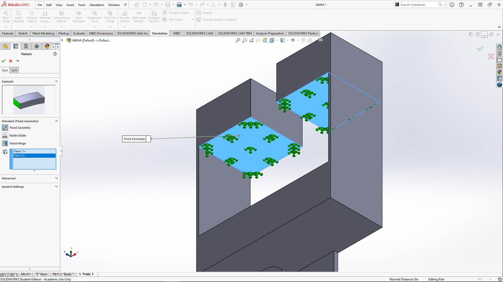
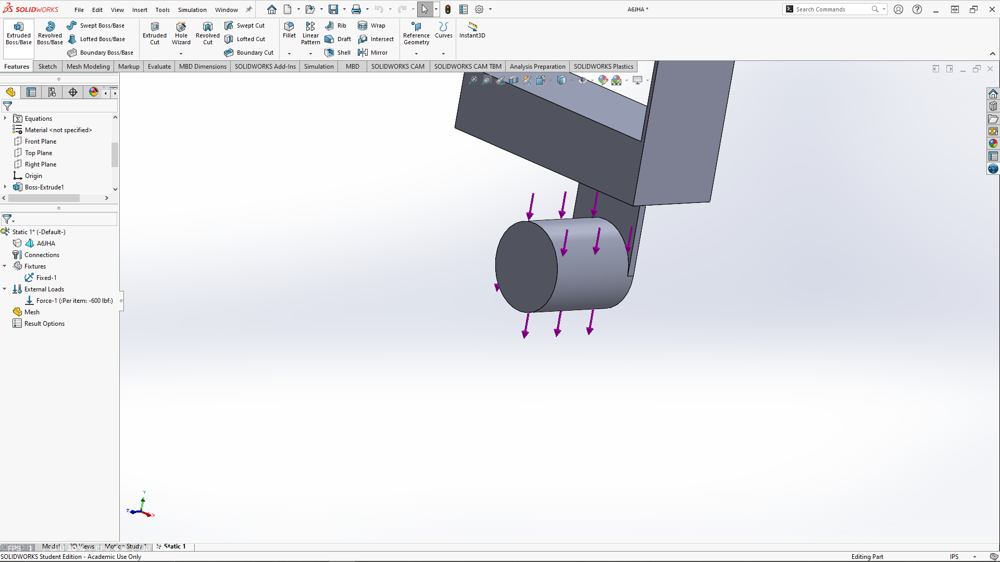
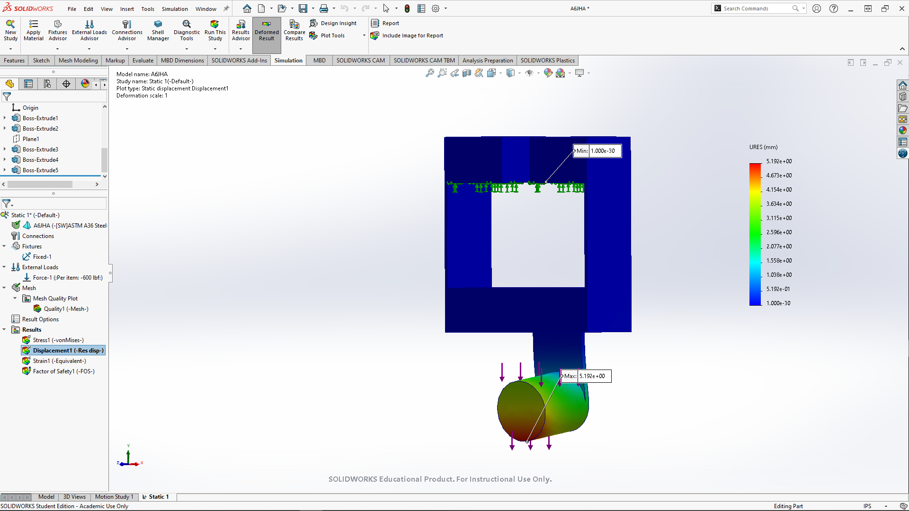
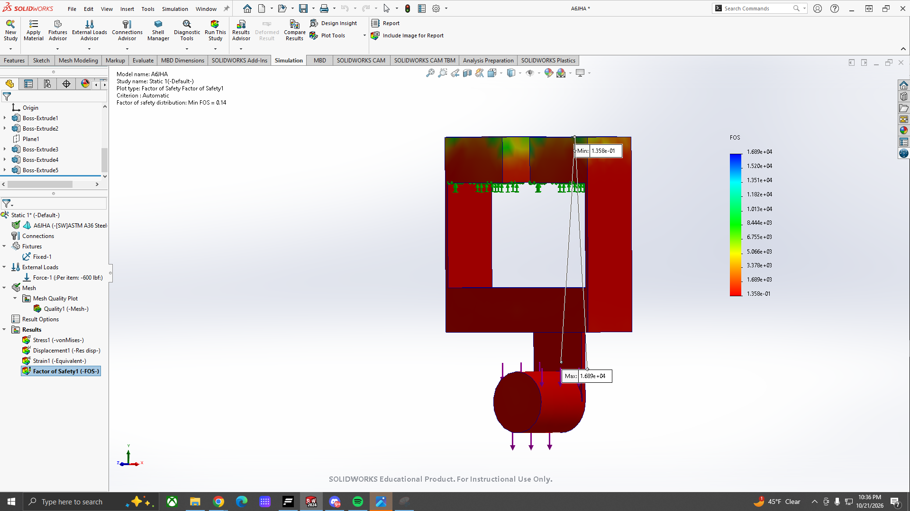
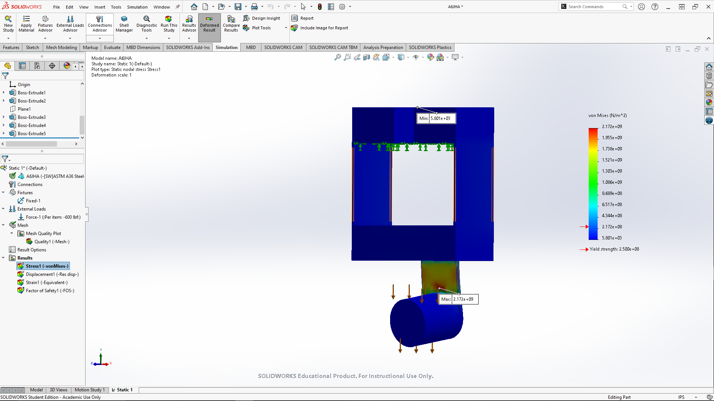
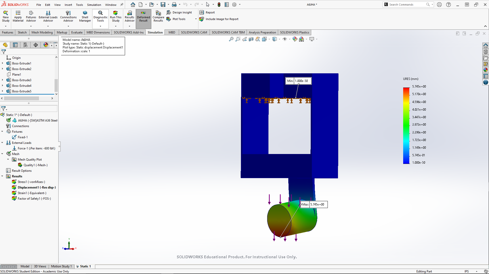
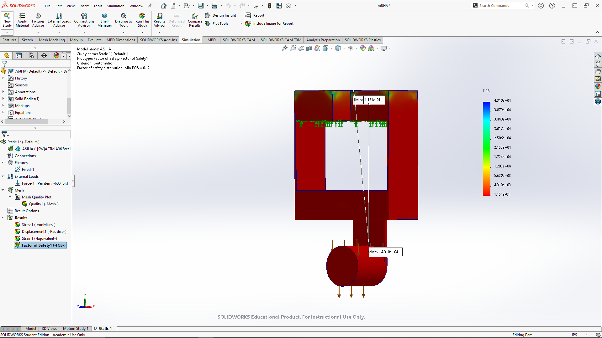
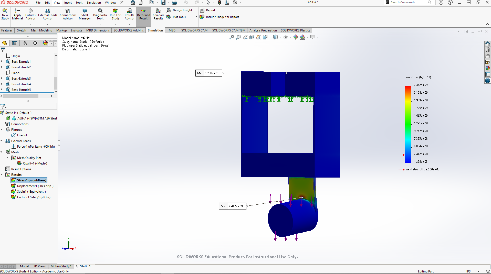
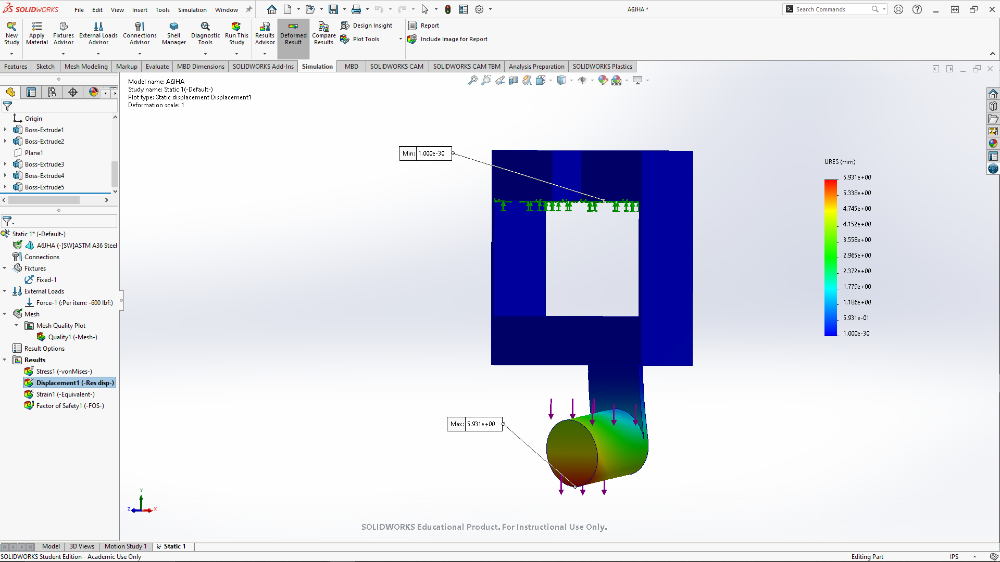
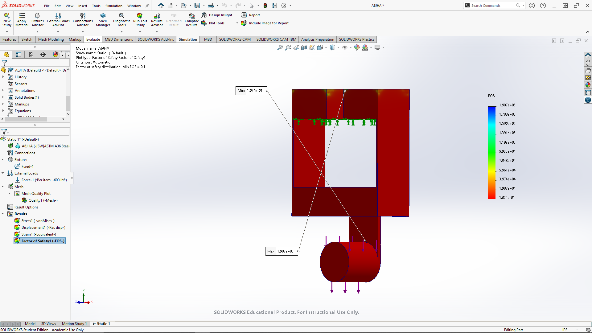

# A7 – FEA Bracket

## Objectives:
- Use Finite Element Analysis (FEA) to improve the bracket design from previous assignments.

- Ensure high stiffness, strength, and lightweight optimization through iterative design.

- Conduct multiple FEA simulations, refining geometry based on results.

- Perform static stress analysis, including constraints, loading, and meshing selection.

- Interpret data by identifying max stress, displacement, and safety factors.

- Optimize the design by modifying geometry to enhance performance.

- Document the entire process with images, calculations, and insights.

- Reflect on key engineering lessons learned and time spent.

## Instructions

Your task is simply to create a high-stiffness, high-strength, and lightweight component. Use Finite Element Analysis to drive your design decisions throughout. At each analysis step, before making geometric changes, ensure the component results (stress/displacement/Safety Factor) converge to within 7%. Achieve this by modifying the number of elements. If after three attempts to converge use the stiffness and stress from the finer mesh size use the finest mesh size and proceed through the process.

## Initial

## Design 1 - Original Bracket

### Mesh 1: Coarse

### Mesh 2: Mid

### Mesh 3: Fine

| Design 1 | Coarse | Default | Fine |
| :--- | :--- | :--- | :--- |
| Max Stress (N/m^2) | 1.841e + 09 | 2.172e + 09 | 2.442e + 09 |
| Max Deflection (mm) | 5.192 | 5.745 | 1.000e -30 |
| Mass (lb) | 1.07 | 1.07 | 1.07 |
| Min FOS | .1358 | .1151 | .1358 |
| # Elements | 1425 | 9690 | 64165 |
| Stress % | | 15.2% | 11.0% |

Due to the results not converging, the finest mesh simulation will be used as stated in the instructions.

## Second Design

