# A8 – Gears

## Objective
- Design a gearbox that can be assembled and disassembled.

- Analyze and size input and output shafts for strength.

- Design journal bearings to support shafts.

- Create a gearbox housing with proper clearance and fastening.

- Use parametric CAD modeling to generate a final design.

- Document calculations, sketches, and lessons learned.

Description:

Design a gearbox that can be assembled and disassembled. The spur gears have a gear ratio of 24:9 and are listed in the resource section. The output gear torque and speed are to be 1.25 in-lbf and 1100 rpm, respectively. The input (pinion,power-transmission) and output (gear, short shaft) shaft diameters are .125 and .25 inches, respectively, and each has a length of 1 inch. Use the appropriate equations in the Machinery’s Handbook for empirical units. The critical features of the gearbox include the shafts and the journal bearings.

## Input Shaft Design

This analysis verified that the baseline 0.125-inch diameter and 1 in length of the input (power-transmission) shaft are structurally sufficient to withstand the applied operating loads. Accounting for the 24:9 gear ratio, the input speed and torque were scaled to 2933.33 RPM and 0.46875 in · lbf, respectively. After formulating the free-body diagram and modeling the torsional shear stress equations from the Machinery's Handbook, the numerical shear stress was evaluated at 1222.30 psi, well below the allowable yield strength of 4000 psi. Furthermore, solving for the minimum required diameter yielded approximately 0.0841 in (compared to the 0.125 in baseline), confirming that the initial dimensions are more than sufficient and require no modification.

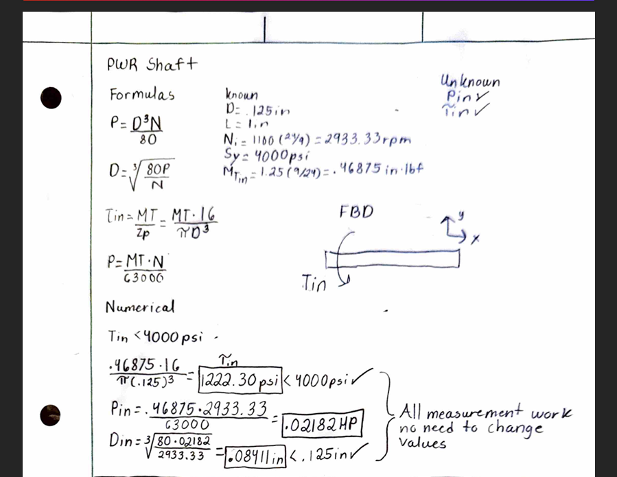

## Output Shaft Design

For the output (short) shaft, the design process mirrored the input analysis to evaluate structural integrity under the direct output specifications of 1100 RPM and 1.25 in*lbf torque across a 0.25 in diameter and 1 in  length. Utilizing an allowable yield strength of 8500 psi, the torsional equations were modeled algebraically and solved numerically. The resulting shear stress was calculated to be 407.43 psi, safely below the allowable limit. Additionally, the minimum required diameter was calculated to be approximately 0.0910 in, validating that the baseline 0.25 in shaft diameter provides an ample safety margin and is completely adequate for the gearbox assembly.   

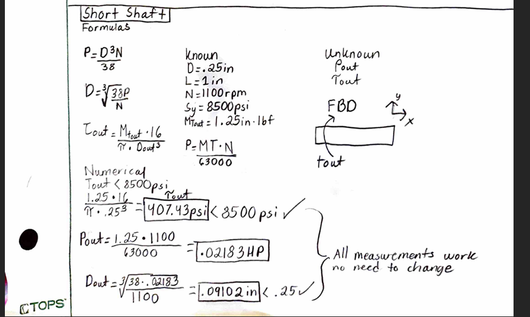

## Design Journal Bearings.

The journal bearing analysis was conducted using the input (power-transmission) shaft parameters as a conservative design approach, since its operating values yield higher speeds and loads. Using a bearing length of 0.375 in and a 20 deg pressure angle, the tangential and radial forces were calculated to determine the surface velocity of 95.99 ft/min and a projected bearing pressure of 19.41 psi. Combining these yielded a PV rating of 1863.17 psi*ft/min, leading to the selection of a dry-running MDS-filled nylon sleeve bearing referenced from the Machinery's Handbook. 

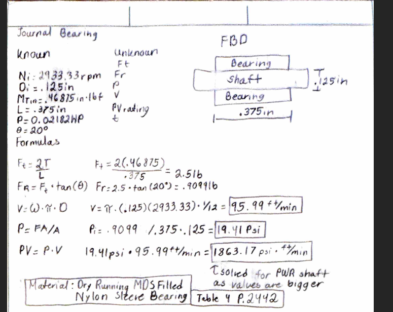

## Journal Bearing Thickness
To verify structural integrity against internal loading, the wall thickness of the journal bearing was calculated using a cylindrical hoop stress model. With an allowable material pressure limit of 1000 psi for nylon, an inner radius of 0.0625 in, and the operating pressure of 19.41 psi, the algebraic equation was solved to find a minimum required wall thickness of 0.00121 in. 

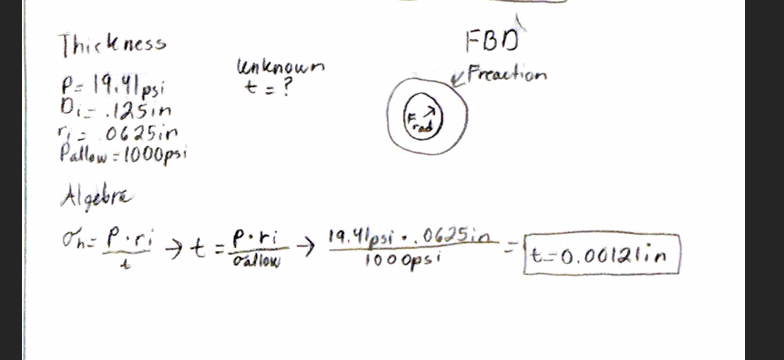

## Gearbox Hand-drawn Design

For my gearbox design, I chose to go with a simple box that held both gears using the shaft and cutting holes both in the box and the plate, and they are to be held by screws.
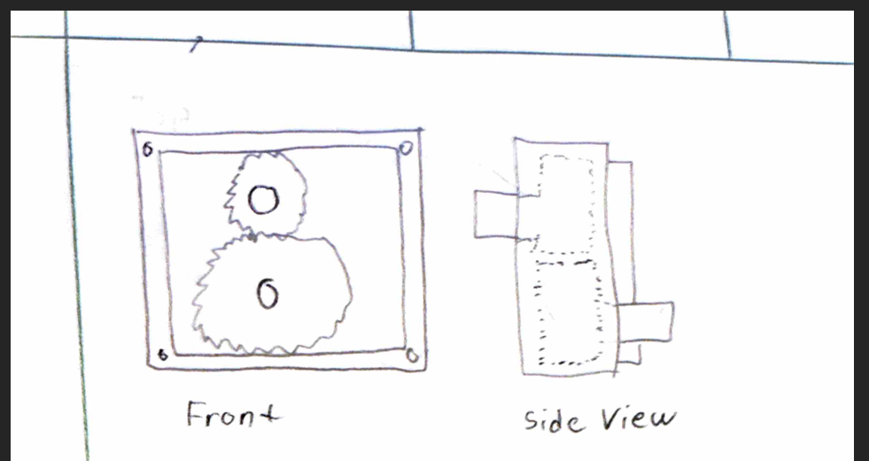
## Modeling & CAD

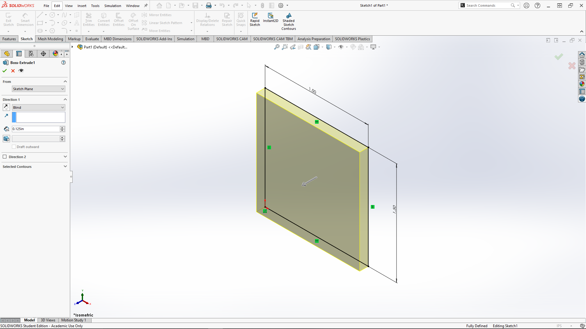
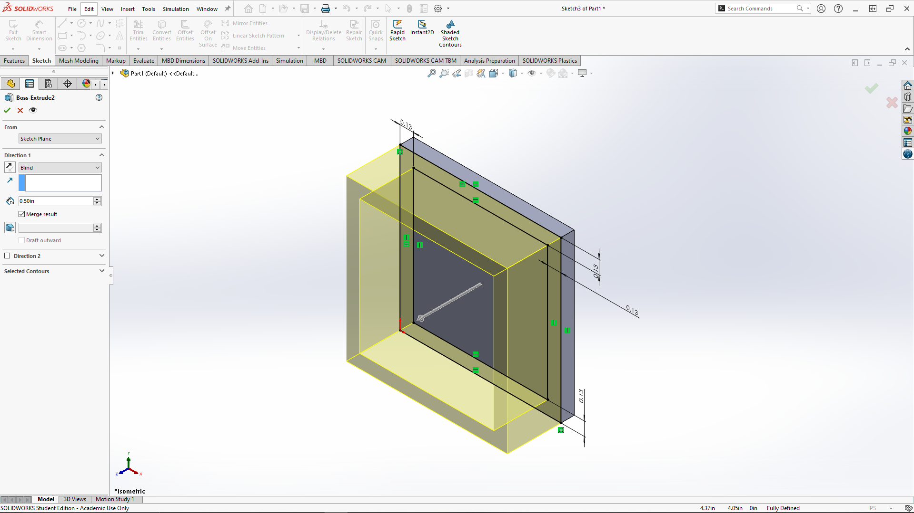
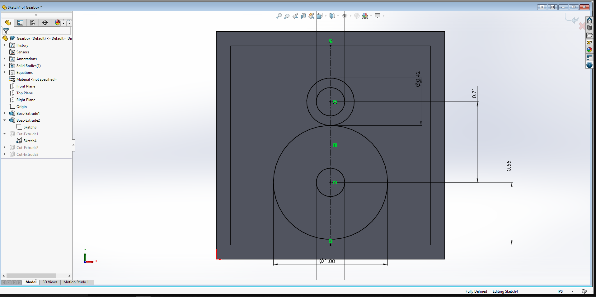
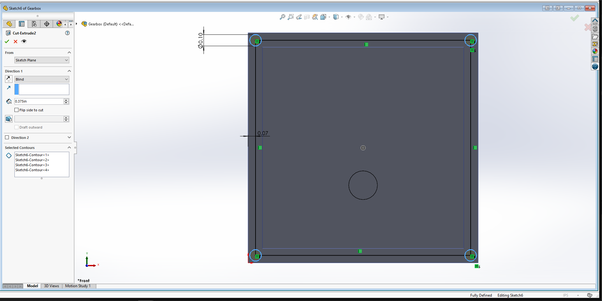
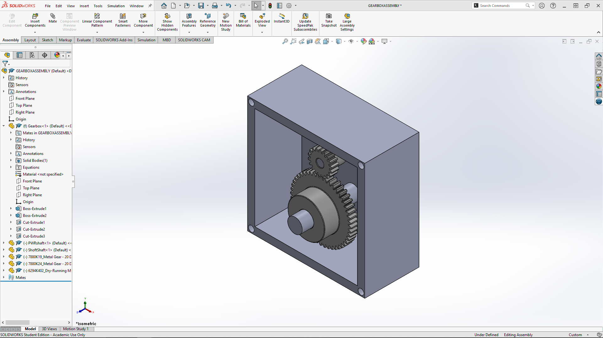
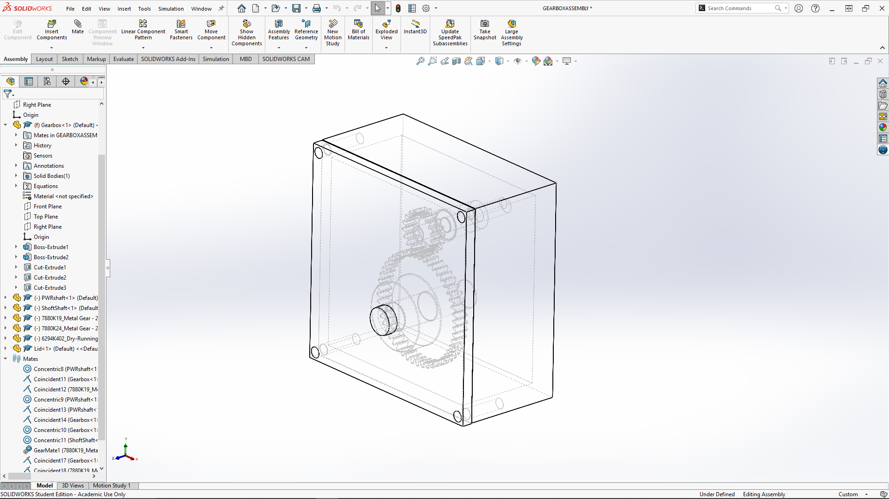

## Reflection

Throughout this assignment, several key engineering lessons were learned regarding systematic mechanical design and documentation. Maintaining strict alignment between empirical units in the Machinery's Handbook and calculated parameters proved essential for accurate stress and power verification. Properly accounting for the 24:9 gear ratio was critical when translating output torque and speed specifications back to the input power shaft. Adopting a conservative design approach by evaluating journal bearing PV ratings and pressures using the more demanding input shaft operating parameters established a robust baseline for both bushings. Finally, thoroughly documenting all intermediate calculations, free-body diagrams, and component dimensions significantly streamlined the subsequent transition into parametric CAD assembly and multi-view drawing generation. One thing I wish to apply is just to start a little earlier but I enjoy the amount of time spent in SolidWorks generating and making parts based on my calculations.

## CAD FILES

[ASSEMBLY](GEARBOXASSEMBLY.SLDASM)

[PWR Shaft](PWRshaft.SLDPRT)

[Lid](Lid.SLDPRT)

[Gearbox](Gearbox.SLDPRT)

[Short Shaft](ShoftShaft.SLDPRT)

## 2157
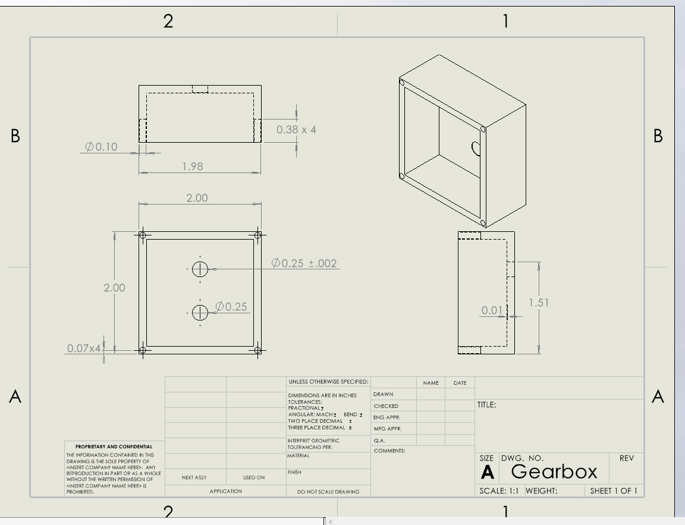
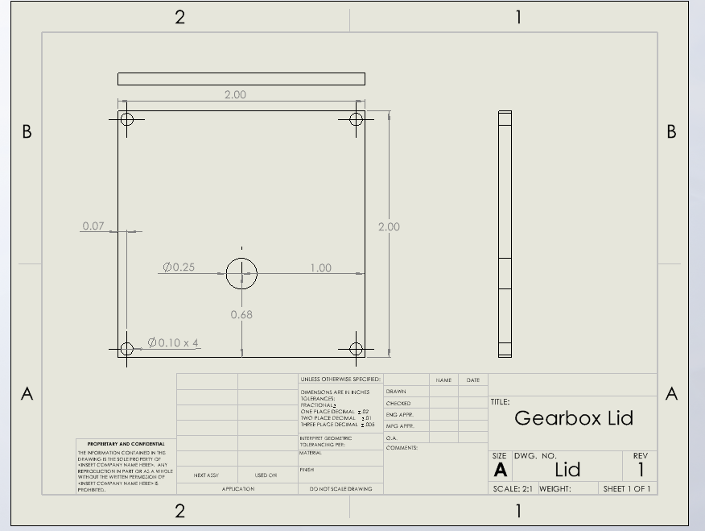
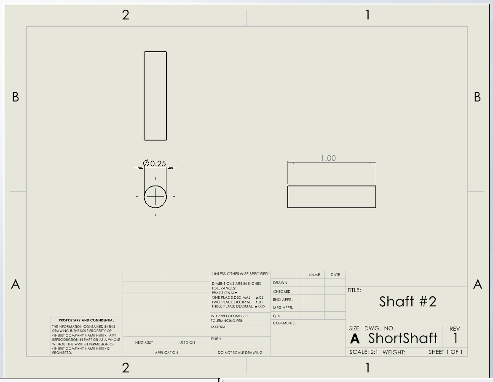
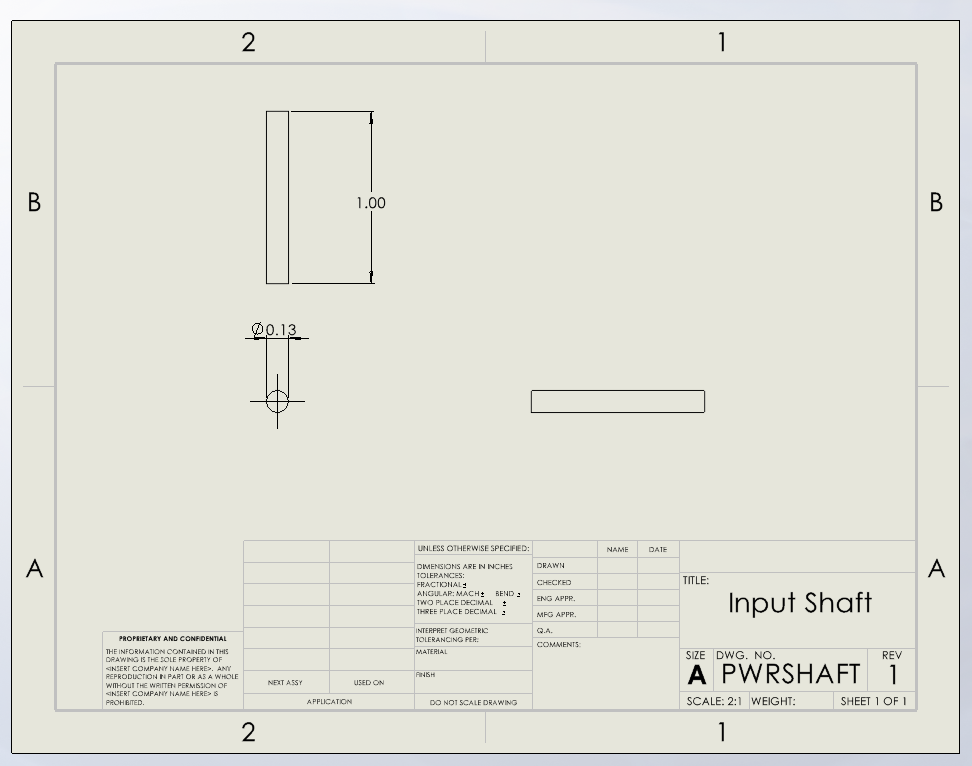
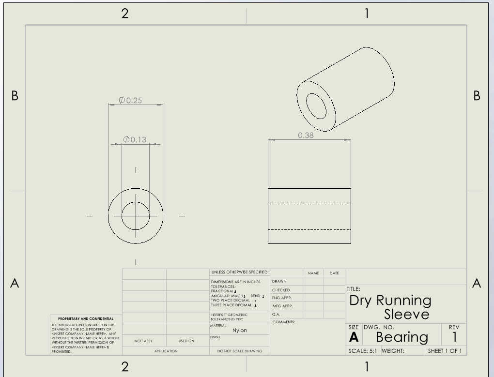

