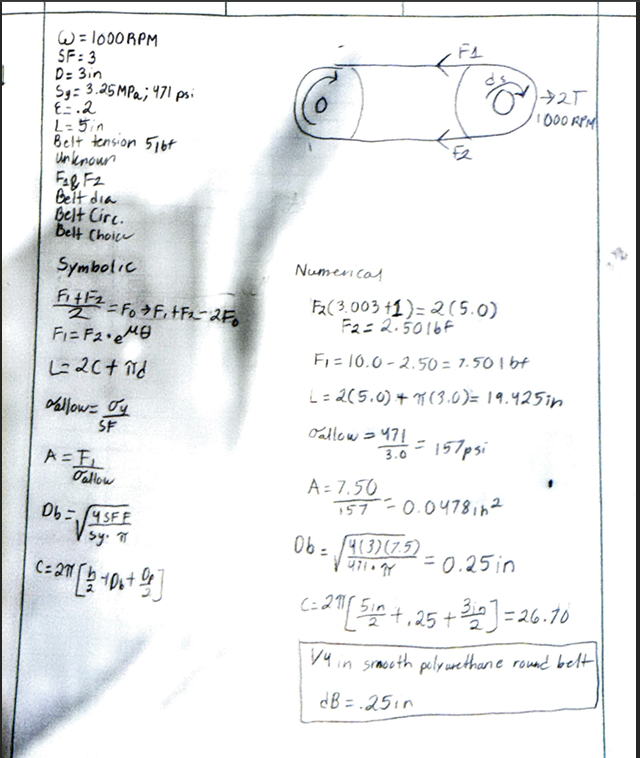
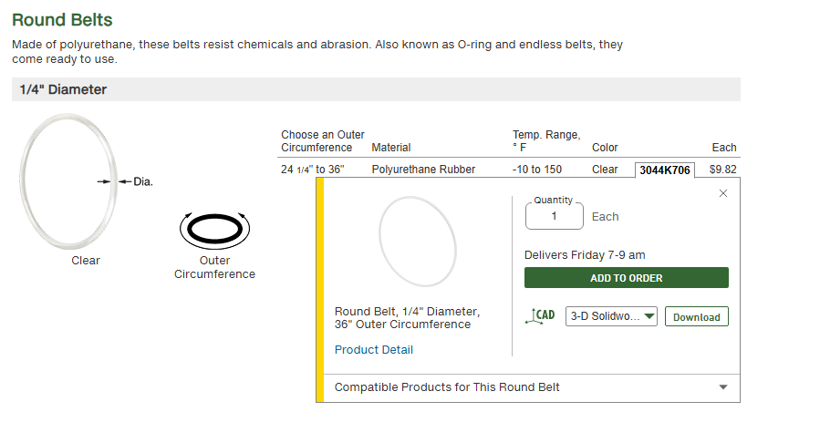
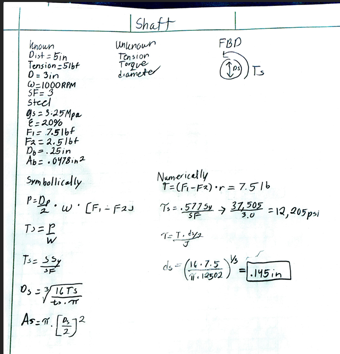
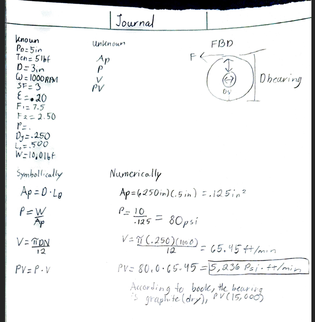
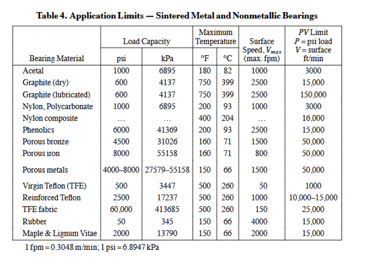
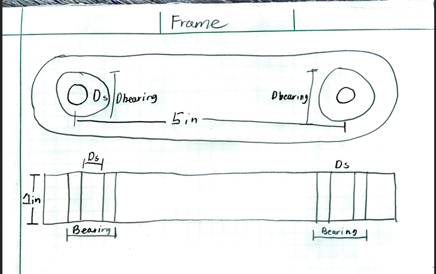

# A9 – Pulleys

## Objective

Design a pulley system to transfer power between two parallel axes separated by a center distance of 4–6 inches. The system must meet the following requirements:

- Pulley Diameter: Both pulleys shall have a diameter of 3 inches. - Rotational Speed: Select an operating speed between 1000–2000 rpm. - Belt Tension (Static): Select a belt tension between 4–6 lbf under stationary conditions. - Material: Pulleys may be made from aluminum, ABS, or steel, and may include a groove and shaft diameter of your choosing (within reasonable manufacturing limits). - Safety Factor: The design must satisfy a minimum safety factor of 3.

## Belt Design

For part 1, I calculated the forces on both the tight and loose sides with no slippage. Calculate the diameter of the belt using the normal stress equation and yield strength. Calculate the belt's outer circumference, then select a suitable belt. I chose 5 inches in length; the pulleys are made of steel, and the belt tension I chose was 5 lbf. After all of my calculations, I went into the McMaster-Carr website and chose the corresponding belt for my project, which is shown below. 

## Shaft Design 

For part 2, I was tasked with determining the minimum shaft diameter by calculating the minimum area required for a shaft made of 1060 hardened steel under torque.

## Journal Bearing Design

For part 3, I was tasked with designing the journal bearing out of sintered metal or non-metallic material using Table 4 on pg 2440 in the Machinery’s Handbook. Determine the pressure. Determine the linear velocity, determine the PV rating, and select a suitable material. As shown below my final number was 5,236 psi * ft/min, when looking at the chart from the book I chose to go with a dry graphite bearing material since the PV limit is 15000.

## Frame Design

For my frame, I based it on the given design.

## Conclusion

The assignment took me about 4 hours. This design exercise provided critical insights into the integration of empirical constraints and analytical mechanics in mechanical power transmission. Pulleys are a fundamental lesson that I personally learned a lot from, as I feel that knowing how to manipulate the formulas will be beneficial in the real world. I also gathered more information regarding how PV rating works and feel more confident about it. Knowing how to do the correct math, along with real-world common sense, made this assignment easier to do and understand. One more valuable lesson I gathered from this assignment was how important it is to do the right math so you can choose the correct material; that way, not only are you building a working fixture, but you can also manage cost appropriately.
